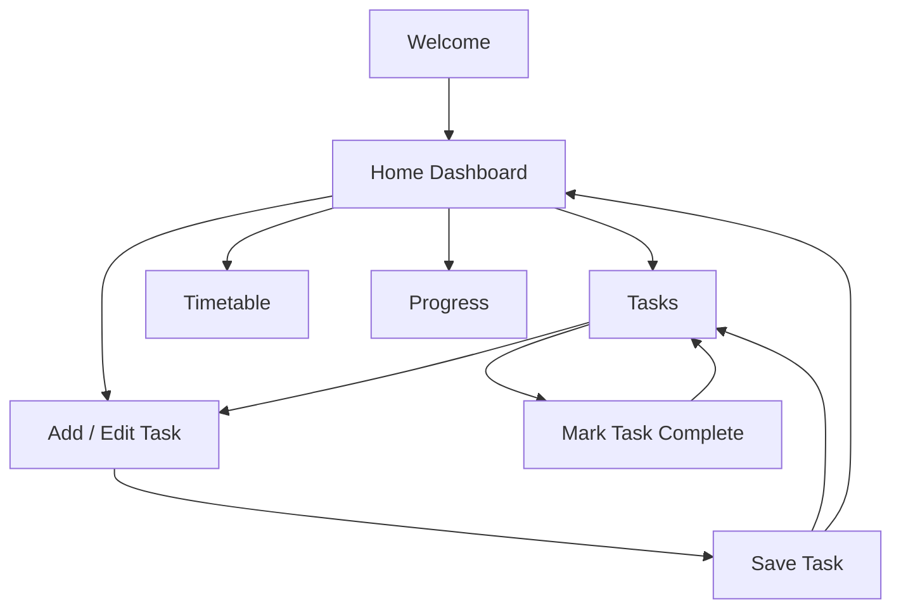

# StudyFlow — App Concept and Screen Flow

**Task:** SWYNEX Task 1 — App Concept and Screen Flow  
**Product type:** Student productivity utility  
**Target user:** College and university students managing assignments, classes, and study goals.

## 1. App idea
StudyFlow helps students organize academic tasks, upcoming classes, deadlines, and study progress in one simple mobile-first experience.

## 2. Problem
Students often track assignments and schedules across notebooks, chats, calendars, and reminders. This can make deadlines easy to miss and daily priorities unclear.

## 3. Product goal
Help a student quickly answer:
- What should I work on today?
- What is due next?
- When is my next class?
- How much have I completed this week?

## 4. Target user
**Aarav, 20 — undergraduate student.** Aarav manages classes, assignments, and exam preparation using his phone. He wants a simple planner that shows the next action without unnecessary complexity.

## 5. Primary screens (6)

| Screen | Purpose | Key content | Main action |
|---|---|---|---|
| 1. Welcome | Explain the app's value | Headline, benefits, Get Started | Continue |
| 2. Home Dashboard | Show today's priorities | Tasks due, next class, daily progress, priority tasks | Add task / open section |
| 3. Tasks | Organize academic work | All, Today, Upcoming, Completed filters; task list and priorities | Complete or add task |
| 4. Add / Edit Task | Capture a task | Title, subject, due date, priority, optional notes | Save task |
| 5. Timetable | Review classes and study sessions | Day selector, chronological time blocks, subject and time | View schedule |
| 6. Progress | Review consistency | Weekly completion, completed vs pending tasks, subject summary | Review progress |

## 6. Navigation flow
- Welcome → Home Dashboard (for this concept, onboarding is represented as a simple entry flow).
- Home Dashboard ↔ Tasks.
- Home Dashboard ↔ Timetable.
- Home Dashboard ↔ Progress.
- Home Dashboard or Tasks → Add / Edit Task → Save → Tasks or Home Dashboard.
- Task rows can be marked complete from the Tasks screen.

## 7. User flow diagram

## 8. Sample UI copy
- Welcome headline: **Make every study session count.**
- Supporting text: “Plan classes, track assignments, and see progress in one simple place.”
- Dashboard greeting: “Good morning, Aarav.”
- Empty tasks state: “You're all caught up. Add a task whenever something comes up.”
- Save confirmation: “Task saved. You're one step ahead.”
- Progress message: “Small steps add up. Keep going.”

## 9. UX principles
- Clear labels and concise language.
- Make the next action easy to find.
- Use readable text and sufficient contrast.
- Do not rely on color alone to communicate task status.
- Encourage progress without shaming users for missed goals.

## 10. Scope and assumptions
This submission documents the concept, six primary screens, content, and navigation. It does not claim that authentication, cloud sync, or notifications are implemented. Any demo should accurately describe the work shown as a concept or prototype.

## 11. Next steps
1. Create wireframes or a clickable prototype for the six screens.
2. Test the main flow: Home → Add Task → Save → Tasks.
3. Record a short demo walkthrough.
4. Publish this repository and include its URL in the LinkedIn post.
