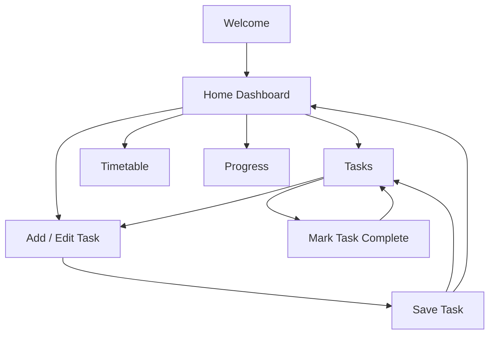

# StudyFlow — Navigation Flow

## Main journey: add an assignment
1. Open Home Dashboard.
2. Select **+ Add task**.
3. Enter task title, subject, due date, and priority.
4. Select **Save Task**.
5. See a confirmation and return to Home or Tasks.
6. Find the task in the list and mark it complete when finished.
